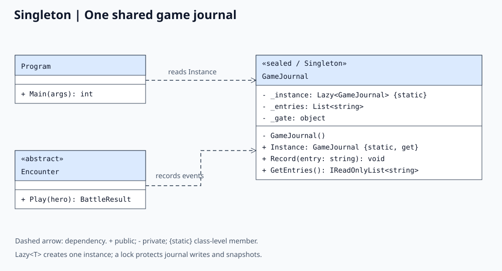
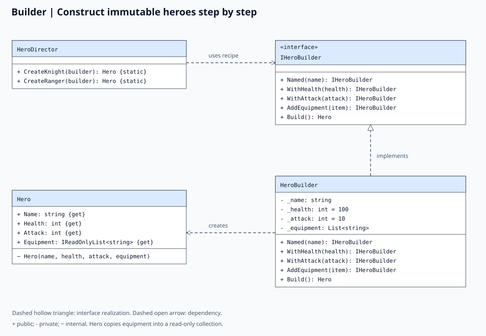
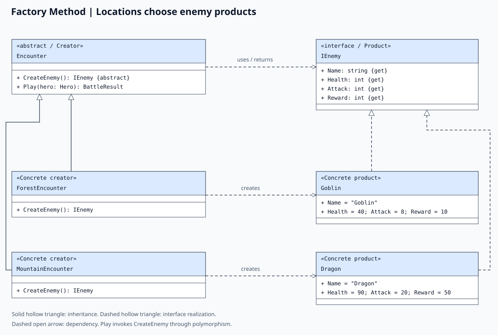

# Laboratory 1.1: Three Creational Design Patterns

## Objective

Implement Singleton, Builder, and Factory in a coherent application and explain their responsibilities, pseudocode, and UML class relationships.

## Project: Dungeon Expedition

Dungeon Expedition is a deterministic C# console game demo targeting .NET 10. It builds a knight and a ranger, sends the knight through forest and mountain encounters, and prints the shared game journal and total gold. The program runs automatically without keyboard input or external packages.

The knight attacks first in each turn. A living enemy retaliates; a defeated enemy cannot. Each encounter starts with the hero's full configured health. Victory awards the enemy's gold reward; defeat awards zero gold. Equipment describes the hero's loadout and does not modify combat statistics. The ranger demonstrates a second construction recipe; the knight fights both encounters.

| Pattern | Implementation | Responsibility |
| --- | --- | --- |
| Singleton | `GameJournal` | Provide one shared, in-memory event journal per application process. |
| Builder | `IHeroBuilder`, `HeroBuilder`, `HeroDirector`, `Hero` | Assemble validated hero configurations through readable construction steps. |
| Factory Method | `Encounter`, `ForestEncounter`, `MountainEncounter`, `IEnemy`, `Goblin`, `Dragon` | Let encounter subclasses choose enemies while reusing the battle algorithm. |

## Run the project

Prerequisite: .NET 10 SDK. From the repository root:

```powershell
dotnet build Lab1.1.Three-creational-design-patterns
dotnet run --project Lab1.1.Three-creational-design-patterns
dotnet run --project Lab1.1.Three-creational-design-patterns -- --self-test
```

The last command runs dependency-free behavioral checks and returns a nonzero exit code if a check fails. Unknown command-line arguments print usage and return exit code 1.

## 1. Singleton: GameJournal

### Intent and implementation

Singleton provides one instance and a global access point. Both the encounter code and the console entry point retrieve `GameJournal.Instance`, so all recorded events appear in the same journal.

In [Patterns/Singleton.cs](Patterns/Singleton.cs), `GameJournal` is sealed and its constructor is private. A static `Lazy<GameJournal>` creates and safely publishes the instance on first access. Its default initialization mode is thread-safe. A separate lock protects the mutable list during writes and snapshot creation. `GetEntries()` returns a read-only snapshot, preventing callers from modifying the journal or observing changes through an earlier snapshot. Blank entries are rejected.

### Pseudocode

```text
sealed class GameJournal
    private static instance = ThreadSafeLazy(() => new GameJournal())
    private entries = empty list
    private gate = new lock

    private constructor()

    static property Instance
        return instance.Value

    method Record(entry)
        require entry is not null, empty, or whitespace
        lock gate
            entries.Add(entry)

    method GetEntries()
        lock gate
            return ReadOnly(Copy(entries))

// Independent callers receive the same object.
journalA = GameJournal.Instance
journalB = GameJournal.Instance
assert ReferenceEquals(journalA, journalB)
```

### UML class diagram



### Benefits and tradeoffs

The journal has one lifetime and a consistent event history without passing it through each call. Global mutable state also couples callers and survives between operations in the same process. A larger application could inject a journal interface to improve isolation in tests. This demo's journal is not persisted to disk.

## 2. Builder: Hero construction

### Intent and implementation

Builder separates step-by-step construction from the resulting object. In [Patterns/Builder.cs](Patterns/Builder.cs), `IHeroBuilder` defines the steps, `HeroBuilder` stores construction state, `Hero` is the immutable product, and `HeroDirector` supplies knight and ranger recipes.

Fluent methods return `IHeroBuilder`, allowing calls to be chained. A name is required; health and attack must be positive. Defaults are 100 health and 10 attack. Equipment is optional, and blank equipment names are rejected. `Build()` creates a new hero and copies equipment into a read-only collection. The builder keeps its state, so later changes do not affect earlier heroes. Director recipes receive a fresh builder to avoid accumulating equipment across recipes.

### Pseudocode

```text
interface IHeroBuilder
    Named(name): IHeroBuilder
    WithHealth(health): IHeroBuilder
    WithAttack(attack): IHeroBuilder
    AddEquipment(item): IHeroBuilder
    Build(): Hero

class HeroBuilder implements IHeroBuilder
    private name = ""
    private health = 100
    private attack = 10
    private equipment = empty list

    method Named(value)
        require value is not blank
        name = Trim(value)
        return this

    method WithHealth(value)
        require value > 0
        health = value
        return this

    method WithAttack(value)
        require value > 0
        attack = value
        return this

    method AddEquipment(item)
        require item is not blank
        equipment.Add(Trim(item))
        return this

    method Build()
        require name is not blank
        return new immutable Hero(name, health, attack, ReadOnly(Copy(equipment)))

class HeroDirector
    static method CreateKnight(builder)
        return builder.Named("Aria").WithHealth(100).WithAttack(25)
                      .AddEquipment("Sword").AddEquipment("Shield").Build()

    static method CreateRanger(builder)
        return builder.Named("Rowan").WithHealth(75).WithAttack(30)
                      .AddEquipment("Bow").AddEquipment("Cloak").Build()
```

### UML class diagram



### Benefits and tradeoffs

Construction reads like a recipe and avoids a constructor with many positional arguments. Validation stays near the construction steps, and the product remains immutable during gameplay. The interface and director add classes that would be unnecessary for a product with only one or two simple properties. Builders are intended for local, sequential use; they are not shared between threads.

## 3. Factory Method: Enemy creation

### Intent and implementation

Factory Method defines a creation operation in a base creator and lets subclasses decide which concrete product to instantiate. The project uses the Factory Method variant of the Factory pattern.

In [Patterns/Factory.cs](Patterns/Factory.cs), `Encounter` is the abstract creator. Its `Play(hero)` method invokes the abstract factory method `CreateEnemy()` and then operates through `IEnemy`. `ForestEncounter` returns a new `Goblin`; `MountainEncounter` returns a new `Dragon`. These are concrete creators and concrete products, respectively. Each factory call returns a fresh enemy.

The client selects encounter objects, while enemy construction belongs to the encounter subclasses. A new location and enemy can be added by implementing `IEnemy` and subclassing `Encounter`, without changing the shared combat algorithm. The client must still choose to include the new location in its itinerary.

### Pseudocode

```text
interface IEnemy
    Name, Health, Attack, Reward: read-only properties

class Goblin implements IEnemy
    Name = "Goblin"; Health = 40; Attack = 8; Reward = 10

class Dragon implements IEnemy
    Name = "Dragon"; Health = 90; Attack = 20; Reward = 50

abstract class Encounter
    abstract method CreateEnemy(): IEnemy

    method Play(hero): BattleResult
        require hero is not null
        enemy = CreateEnemy()
        heroHealth = hero.Health
        enemyHealth = enemy.Health
        GameJournal.Instance.Record(hero.Name + " encounters " + enemy.Name)

        while heroHealth > 0 and enemyHealth > 0
            enemyHealth = enemyHealth - hero.Attack
            if enemyHealth > 0
                heroHealth = heroHealth - enemy.Attack

        won = heroHealth > 0
        gold = enemy.Reward if won else 0
        GameJournal.Instance.Record(battle outcome)
        return BattleResult(won, Max(0, heroHealth), gold)

class ForestEncounter extends Encounter
    override method CreateEnemy(): IEnemy
        return new Goblin()

class MountainEncounter extends Encounter
    override method CreateEnemy(): IEnemy
        return new Dragon()
```

### UML class diagram



### Benefits and tradeoffs

The battle algorithm depends on the product interface and is reused for both enemy types. Choosing a product is delegated to a concrete creator. This requires a creator subclass per location; a simple static factory could use fewer classes for a small fixed set, but would not demonstrate creation through an overridden factory method.

## How the patterns cooperate

1. `Program` asks `HeroDirector` to build heroes through fresh `HeroBuilder` instances.
2. It stores forest and mountain locations in an `Encounter[]`.
3. Each `Play()` call obtains its enemy through the overridden `CreateEnemy()` method.
4. Combat records its start and result in `GameJournal.Instance`.
5. `Program` reads that same journal and totals the returned gold rewards.

## Observed console output

```text
=== Dungeon Expedition: Creational Patterns ===

[Builder] Two heroes assembled using different recipes:
Aria: HP=100, Attack=25, Equipment=[Sword, Shield]
Rowan: HP=75, Attack=30, Equipment=[Bow, Cloak]

[Factory Method] Explore two locations:
ForestEncounter: Victory=True, HP=92, Gold=10
MountainEncounter: Victory=True, HP=40, Gold=50

[Singleton] Same journal instance: True
- Aria encounters a Goblin.
- Aria defeats Goblin with 92 HP and earns 10 gold.
- Aria encounters a Dragon.
- Aria defeats Dragon with 40 HP and earns 50 gold.

Expedition complete. Total gold: 60
```

## Verification

The project builds and the demo produces the output above. `DemoChecks.cs` runs 18 checks covering concurrent Singleton access and journal writes, independent snapshots, rejected blank journal entries, builder reuse and product immutability, missing or invalid builder inputs, correct factory products and fresh instances, victory rewards, defeat, first-strike victory, and null hero rejection.

The knight needs two attacks against the goblin and receives one retaliation: `100 - 8 = 92` health. Against the dragon, the knight needs four attacks and receives three retaliations: `100 - 3 × 20 = 40` health. Gold totals `10 + 50 = 60`.

## Diagram files

The three UML diagrams are SVG images in `images/` and are embedded above. They show the classes relevant to each pattern; supporting types such as `BattleResult` are mentioned in signatures without expanding them. `+` denotes public, `-` private, and `~` internal visibility. Hollow triangles indicate inheritance (solid line) or interface realization (dashed line); dashed open arrows indicate dependencies.

Their editable source is [images/generate_diagrams.py](images/generate_diagrams.py). Regenerate them from the repository root with Python 3; no third-party packages are required:

```powershell
python Lab1.1.Three-creational-design-patterns/images/generate_diagrams.py
```

## Conclusion

The demo demonstrates three distinct creation responsibilities in one application: Singleton controls shared instance lifetime, Builder assembles validated products, and Factory Method delegates product selection to creator subclasses.
