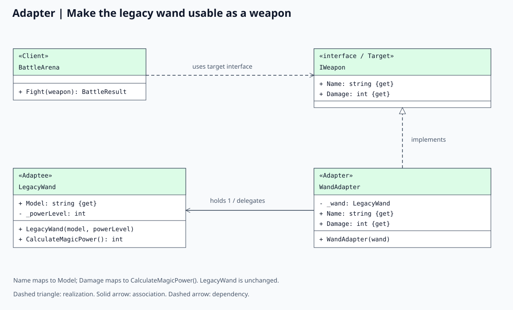
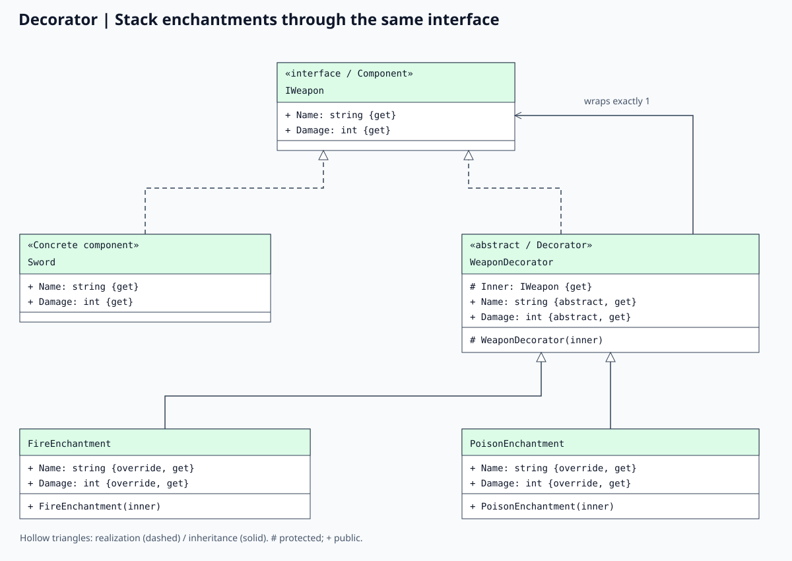
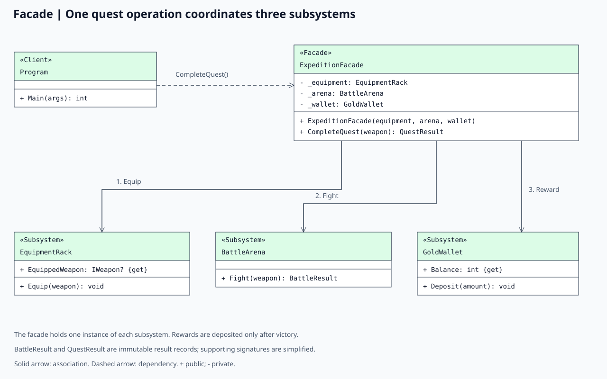

# Laboratory 2: Three Structural Design Patterns

## Objective

Implement three structural design patterns from the course list and demonstrate their use in a working project, including pseudocode and UML class diagrams.

The selected patterns are **Adapter**, **Decorator**, and **Facade**. They are straightforward to compare in a small game: Adapter connects incompatible interfaces, Decorator adds behavior through wrappers, and Facade simplifies interaction with multiple subsystems.

## Project: Enchanted Expedition

Enchanted Expedition is a deterministic C# console game demo targeting .NET 10. A player uses an ordinary sword and an enchanted legacy wand to complete dungeon quests. It runs automatically without keyboard input or third-party packages.

| Pattern | Main classes | Role in the game |
| --- | --- | --- |
| Adapter | `IWeapon`, `LegacyWand`, `WandAdapter` | Make a wand with a different API usable by the equipment and combat systems. |
| Decorator | `WeaponDecorator`, `FireEnchantment`, `PoisonEnchantment` | Add stackable damage bonuses and descriptive names to any `IWeapon`. |
| Facade | `ExpeditionFacade`, `EquipmentRack`, `BattleArena`, `GoldWallet` | Expose one operation that equips a weapon, runs combat, and awards gold. |

### Game rules

- Every quest starts with 100 hero health and a guardian with 60 health.
- The hero attacks first each turn. A surviving guardian retaliates for 15 damage.
- Weapon damage is positive and fixed for the duration of a battle.
- Fire adds 10 damage; poison adds 5 damage. These are immediate bonuses, not effects applied over time.
- A victory awards 20 gold; defeat awards zero gold. Health never appears as a negative result.
- Quests are repeatable: hero and guardian health reset each time, while the wallet retains its balance.

## Running the project

Install the .NET 10 SDK. From the repository root:

```powershell
dotnet build Lab2.Three-structural-desgn-patterns
dotnet run --project Lab2.Three-structural-desgn-patterns
dotnet run --project Lab2.Three-structural-desgn-patterns -- --self-test
```

The self-test command runs dependency-free behavioral checks and returns exit code 1 on failure. Unsupported command-line arguments print usage and return exit code 1.

## 1. Adapter: Connecting a legacy wand

### Intent

Adapter translates the interface of an existing object into the interface expected by its clients. It is useful when integrating an external library or an older component that cannot conveniently be changed.

### Implementation

In [Patterns/Adapter.cs](Patterns/Adapter.cs), combat expects `IWeapon`, which exposes `Name` and `Damage`. `Sword` implements that interface directly. The simulated legacy class `LegacyWand` exposes `Model` and `CalculateMagicPower()` instead; it has no dependency on `IWeapon`.

`WandAdapter` implements the target interface and holds one `LegacyWand`. Its `Name` property returns the wand's model and its `Damage` property calls `CalculateMagicPower()`. This is an **object adapter**, using composition. A power-level 3 wand supplies `3 × 6 = 18` damage.

| Participant | Class |
| --- | --- |
| Target interface | `IWeapon` |
| Adaptee | `LegacyWand` |
| Adapter | `WandAdapter` |
| Client | `BattleArena` and other code accepting `IWeapon` |

### Pseudocode

```text
interface IWeapon
    read-only Name: string
    read-only Damage: integer

class LegacyWand
    read-only Model: string
    private powerLevel: integer

    constructor(model, powerLevel)
        require model is not blank and powerLevel > 0
        Model = Trim(model)
        this.powerLevel = powerLevel

    method CalculateMagicPower()
        return powerLevel * 6

class WandAdapter implements IWeapon
    private wand: LegacyWand

    constructor(wand)
        require wand is not null
        this.wand = wand

    property Name
        return wand.Model

    property Damage
        return wand.CalculateMagicPower()

weapon: IWeapon = new WandAdapter(new LegacyWand("Oak Wand", 3))
```

### UML class diagram



### Benefits and tradeoffs

The existing wand class remains independent of the combat interface, while client code treats the wand like any other weapon. The adapter adds a small layer of indirection and must preserve a meaningful mapping between the two APIs. It translates behavior; it does not add an enchantment bonus.

## 2. Decorator: Stackable enchantments

### Intent

Decorator adds responsibilities to an individual object by wrapping it with another object that exposes the same interface. Multiple wrappers can be composed at runtime.

### Implementation

In [Patterns/Decorator.cs](Patterns/Decorator.cs), `WeaponDecorator` implements `IWeapon` and holds an `IWeapon` in its protected `Inner` property. `FireEnchantment` and `PoisonEnchantment` delegate to that inner object, then extend its name and damage.

The program builds this wrapper chain:

```text
PoisonEnchantment -> FireEnchantment -> WandAdapter -> LegacyWand
```

The first three objects expose `IWeapon`. The final object is reached through the adapter. The resulting damage is `18 + 10 + 5 = 33`; the original wand still supplies 18. A decorator can also wrap a sword or another decorator. No subclass for every possible weapon/enchantment combination is required.

| Participant | Class |
| --- | --- |
| Component interface | `IWeapon` |
| Concrete component | `Sword`, or an adapted wand |
| Base decorator | `WeaponDecorator` |
| Concrete decorators | `FireEnchantment`, `PoisonEnchantment` |

### Pseudocode

```text
abstract class WeaponDecorator implements IWeapon
    protected read-only inner: IWeapon

    constructor(inner)
        require inner is not null
        this.inner = inner

    abstract read-only Name
    abstract read-only Damage

class FireEnchantment extends WeaponDecorator
    property Name
        return inner.Name + " + Fire"

    property Damage
        return inner.Damage + 10

class PoisonEnchantment extends WeaponDecorator
    property Name
        return inner.Name + " + Poison"

    property Damage
        return inner.Damage + 5

enchanted: IWeapon = new PoisonEnchantment(new FireEnchantment(weapon))
assert enchanted.Damage == 33
assert weapon.Damage == 18
```

### UML class diagram



### Benefits and tradeoffs

Enchantments can be combined without changing the wrapped object or creating many weapon subclasses. Wrappers introduce additional objects and delegation steps, making long chains harder to inspect. For these additive bonuses, reversing the order preserves damage, but changes the displayed suffix order. Other kinds of decorators could have order-dependent behavior. Repeating an enchantment stacks its bonus again; the demo imposes no uniqueness rule.

## 3. Facade: Completing a quest

### Intent

Facade offers a simplified entry point to a group of subsystems. It coordinates an operation that would otherwise require the client to know the subsystem call sequence.

### Implementation

In [Patterns/Facade.cs](Patterns/Facade.cs), `ExpeditionFacade.CompleteQuest(weapon)` performs three steps:

1. `EquipmentRack.Equip()` validates and stores the selected weapon.
2. `BattleArena.Fight()` resolves the battle using the equipped weapon.
3. `GoldWallet.Deposit()` adds 20 gold only if the hero wins.

The facade returns an immutable `QuestResult`, containing the `BattleResult`, gold earned, and total balance. Its constructor receives the three subsystem objects, making their shared state explicit. The subsystems can also be used independently; the facade does not replace their interfaces.

| Participant | Class |
| --- | --- |
| Client | `Program` |
| Facade | `ExpeditionFacade` |
| Subsystems | `EquipmentRack`, `BattleArena`, `GoldWallet` |
| Result objects | `BattleResult`, `QuestResult` |

### Pseudocode

```text
class EquipmentRack
    read-only-to-clients EquippedWeapon

    method Equip(weapon)
        require weapon is not null and weapon.Damage > 0
        EquippedWeapon = weapon

class BattleArena
    method Fight(weapon)
        require weapon is not null and weapon.Damage > 0
        damage = weapon.Damage
        heroHealth = 100
        guardianHealth = 60
        turns = 0
        while heroHealth > 0 and guardianHealth > 0
            turns = turns + 1
            guardianHealth = guardianHealth - damage
            if guardianHealth > 0
                heroHealth = heroHealth - 15
        return BattleResult(heroHealth > 0, turns, Max(0, heroHealth))

class GoldWallet
    Balance = 0

    method Deposit(amount)
        require amount > 0
        Balance = Balance + amount

class ExpeditionFacade
    private equipment, arena, wallet

    constructor(equipment, arena, wallet)
        require all three subsystems are not null
        store subsystem references

    method CompleteQuest(weapon)
        equipment.Equip(weapon)
        battle = arena.Fight(equipment.EquippedWeapon)
        reward = 20 if battle.Won else 0
        if reward > 0
            wallet.Deposit(reward)
        return QuestResult(battle, reward, wallet.Balance)
```

### UML class diagram



### Benefits and tradeoffs

The client expresses a quest in one call and does not duplicate orchestration or reward rules. The facade remains coupled to its subsystem interfaces and could become too large if unrelated responsibilities were added. This demo keeps only the quest workflow in it. It is an in-memory, sequential application without persistence or transaction recovery.

## How the patterns cooperate

`Program` first adapts a legacy wand into `IWeapon`, then wraps that adapter with fire and poison decorators. It passes the resulting weapon to the facade. The facade uses the same `IWeapon` contract as an ordinary sword while coordinating the equipment, battle, and wallet subsystems.

These patterns address separate structural questions: how to connect an incompatible object, how to compose additional behavior around an object, and how to expose several cooperating objects through a simple operation.

## Observed console output

```text
=== Enchanted Expedition: Structural Patterns ===

[Adapter] Use a legacy wand through IWeapon:
Oak Wand: 18 damage

[Decorator] Stack enchantments without changing the wand:
Oak Wand + Fire + Poison: 33 damage
Original Oak Wand: 18 damage

[Facade] Equip, fight a guardian, and collect the reward:
Iron Sword: Victory=True, Turns=3, HP=70, Gold earned=20, Wallet=20
Oak Wand + Fire + Poison: Victory=True, Turns=2, HP=85, Gold earned=20, Wallet=40
```

The sword needs three attacks against 60 guardian health, receiving two retaliations: `100 - 2 × 15 = 70` health. The enchanted wand needs two attacks, receiving one retaliation: `100 - 15 = 85` health. Two victories award `20 + 20 = 40` gold.

## Verification

`DemoChecks.cs` provides 20 checks covering adapter translation and validation, stacked enchantments, preservation of original weapons, wrapping native weapons, reversed wrapper order, facade coordination and equipment selection, accumulated rewards, defeat without rewards, first-strike victory, and invalid inputs.

The implementation uses checked arithmetic when computing magic power, adding enchantment damage, and updating the wallet, so integer overflow raises an exception instead of silently wrapping. Weapon validation prevents zero or negative damage from causing a nonterminating battle. Each battle also ends after at most seven guardian retaliations because hero health starts at 100 and retaliation damage is 15.

## Files and UML notation

```text
Lab2.Three-structural-desgn-patterns/
  Program.cs                     Console demonstration and argument handling
  DemoChecks.cs                  Dependency-free behavioral checks
  Patterns/
    Adapter.cs                   Weapon interface, sword, legacy wand, adapter
    Decorator.cs                 Base decorator and two enchantments
    Facade.cs                    Facade, three subsystems, result records
  images/
    adapter.svg                  Adapter UML diagram
    decorator.svg                Decorator UML diagram
    facade.svg                   Facade UML diagram
    generate_diagrams.py          Editable diagram generator
  report.md
```

The diagrams focus on each pattern's participants; supporting classes and parameter types may be omitted or simplified. `+` indicates public visibility, `-` private, and `#` protected. Hollow triangle arrowheads indicate interface realization (dashed line) or inheritance (solid line). A solid open arrow represents a directed association; a dashed open arrow represents a dependency. Role labels identify each class's responsibility in the pattern.

The SVG images are embedded above and can be regenerated with Python 3 without external packages:

```powershell
python Lab2.Three-structural-desgn-patterns/images/generate_diagrams.py
```

## Conclusion

Adapter makes the legacy wand compatible with the game, Decorator composes enchantments around weapons, and Facade coordinates a quest through a single entry point. Together they demonstrate how structural patterns organize collaborating objects while keeping each responsibility explicit.
