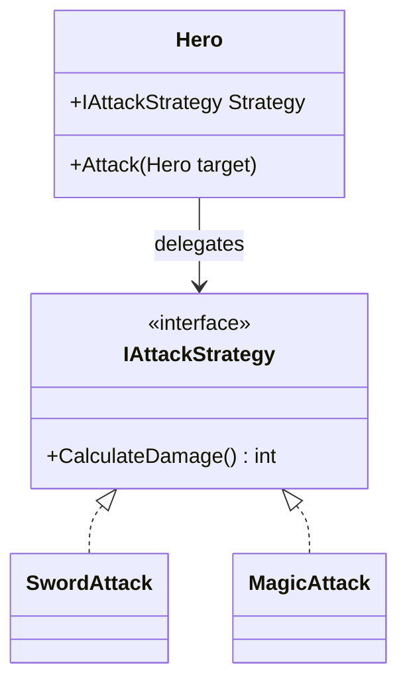
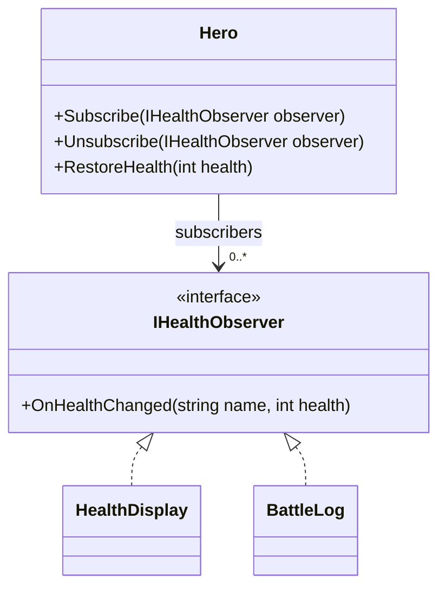
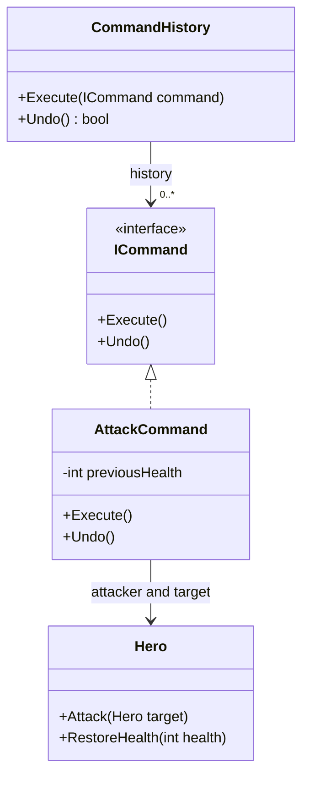

# Laboratory 3 — Behavioral Design Patterns

## Domain description

A standalone console battle demo creates Aria and a guardian through a reusable HeroBuilder. Attacks use an interchangeable damage strategy. Commands retain attack history and support undo. Health changes notify a display and a battle log.

This project follows the assignment's alternative of reusing a creational pattern. HeroBuilder constructs the objects used by all three behavioral patterns. Its fluent steps validate name, health, and strategy before Build creates a new Hero.

## Interaction and runtime changes

The execution path is Program → CommandHistory → ICommand.Execute → Hero.Attack → IAttackStrategy.CalculateDamage → target.ReceiveDamage → IHealthObserver.OnHealthChanged. Undo also invokes the observers through RestoreHealth. Program changes from SwordAttack to MagicAttack and unsubscribes the display during execution.

Domain models reside in Domain/, pattern contracts and implementations in Patterns/, the console client in Program.cs, and unit checks in Tests/. The application is sequential. Undo assumes changes to a target are reversed through the same history in LIFO order. Observer implementations are expected to complete without throwing.

## Strategy

Hero is the context. IAttackStrategy is the strategy interface. SwordAttack and MagicAttack provide interchangeable damage algorithms. Hero.Attack delegates damage calculation through the interface. Program replaces the strategy at runtime.

### Class diagram



### Implementation excerpt

[Source](Patterns/Strategy.cs)

```csharp
namespace Lab3.Behavioral_design_patterns.Patterns;

public interface IAttackStrategy
{
    int CalculateDamage();
}
public sealed class SwordAttack : IAttackStrategy
{
    public int CalculateDamage() => 20;
}
public sealed class MagicAttack : IAttackStrategy
{
    public int CalculateDamage() => 35;
}
```

The implementation communicates through the pattern interface. Concrete algorithms can be added as new strategy classes.

### Unit tests

- Strategy_SwordDamage verifies sword damage is 20.
- Strategy_RuntimeSwap verifies the same hero uses sword then magic, leaving 45 target health.

## Observer

Hero is the subject and stores IHealthObserver subscribers. HealthDisplay and BattleLog are two concrete observers. Subscriptions can be added and removed during execution. The subject notifies a snapshot of subscribers after health changes, including undo restoration.

### Class diagram



### Implementation excerpt

[Source](Patterns/Observer.cs)

```csharp
namespace Lab3.Behavioral_design_patterns.Patterns;

public interface IHealthObserver
{
    void OnHealthChanged(string name, int health);
}
public sealed class HealthDisplay : IHealthObserver
{
    public void OnHealthChanged(string name, int health) =>
        Console.WriteLine($"HUD: {name} has {health} HP");
}
public sealed class BattleLog : IHealthObserver
{
    private readonly List<string> entries = [];
    public IReadOnlyList<string> Entries => entries.AsReadOnly();
    public void OnHealthChanged(string name, int health) =>
        entries.Add($"{name}: {health} HP");
}
```

The implementation communicates through the pattern interface. New subscribers can implement IHealthObserver and register at runtime.

### Unit tests

- Observer_AllSubscribersNotified verifies both subscribed logs receive the new health.
- Observer_UnsubscribeAtRuntime verifies a removed observer receives no further updates.

## Command

ICommand defines Execute and Undo. AttackCommand retains its receiver references and the target's previous health. Hero owns attack and health logic. CommandHistory is the invoker and caretaker of a LIFO command history. Undo restores the captured health and triggers observer notifications.

### Class diagram



### Implementation excerpt

[Source](Patterns/Command.cs)

```csharp
public sealed class AttackCommand(Hero attacker, Hero target) : ICommand
{
    private int previousHealth;
    private bool executed;
    public void Execute()
    {
        if (executed) throw new InvalidOperationException("Undo before executing again.");
        previousHealth = target.Health;
        attacker.Attack(target);
        executed = true;
    }
    public void Undo()
    {
        if (!executed) throw new InvalidOperationException("Execute before undo.");
        target.RestoreHealth(previousHealth);
        executed = false;
    }
}
```

The implementation communicates through the pattern interface. New commands can implement ICommand and use the existing invoker.

### Unit tests

- Command_UndoRestoresHealth verifies execute changes health and undo restores it exactly.
- Command_HistoryIsLifo verifies two commands undo in reverse order and empty undo returns false.

## Pseudocode

```text
hero = builder.Named("Aria").WithStrategy(sword).Build()
target.Subscribe(display)
target.Subscribe(log)
history.Execute(AttackCommand(hero, target))
    capture target health
    hero attacks using current strategy
    target updates health and notifies observers
hero.Strategy = magic
history.Execute(AttackCommand(hero, target))
history.Undo()
    restore captured health and notify observers
target.Unsubscribe(display)
```

## Test log

Run the single test command from README.md. These six named checks cover at least two properties for each behavioral pattern.

```text
PASS Strategy_SwordDamage
PASS Strategy_RuntimeSwap
PASS Observer_AllSubscribersNotified
PASS Observer_UnsubscribeAtRuntime
PASS Command_UndoRestoresHealth
PASS Command_HistoryIsLifo
All 6 tests passed.
```

## Fit and extension

Strategy fits the choice of attack damage. Observer fits multiple reactions to health changes. Command is justified by reversible battle actions and history. For a single fixed attack or one health consumer, these abstractions would add less value.

A defense exercise could add HeavyAttack implementing IAttackStrategy and assign it to Hero.Strategy. A new observer can implement IHealthObserver and subscribe without changing Hero. A new command can implement ICommand without changing CommandHistory.

## Other behavioral patterns

- Chain of Responsibility passes requests through handlers until handled.
- Iterator exposes traversal independently of collection representation.
- Mediator coordinates communication among colleagues.
- Memento captures encapsulated state for later restoration.
- State delegates behavior to objects representing current state.
- Template Method fixes an algorithm skeleton with overridable steps.
- Visitor adds operations through double dispatch over an object structure.
- Interpreter evaluates expressions described by a grammar.

## Conclusions

Coordinating undo and notifications requires restoration to use the same health-update path as ordinary damage. Keeping business rules in Hero lets command objects focus on history. A larger game would benefit from explicit battle sessions owning command history and immutable event payloads.

The submission requires a repository link and meaningful commit history. Repository publication and commits are left to the student's submission workflow. The student should review and explain the implementation and its limitations during the defense, as required by the assignment.
